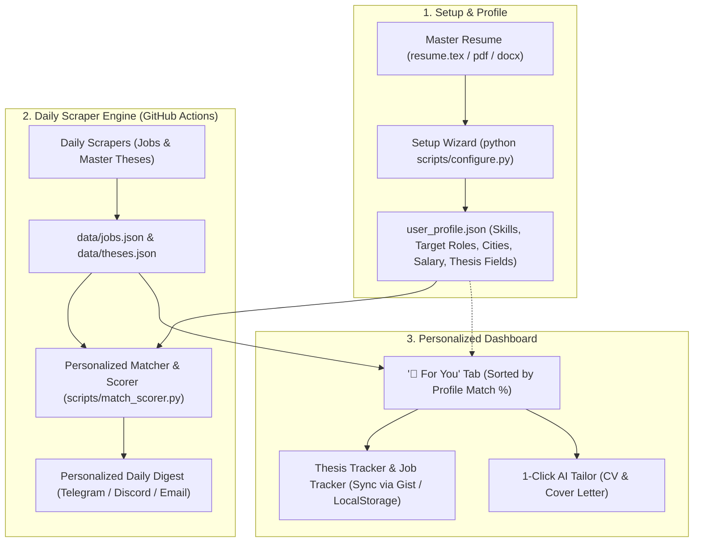
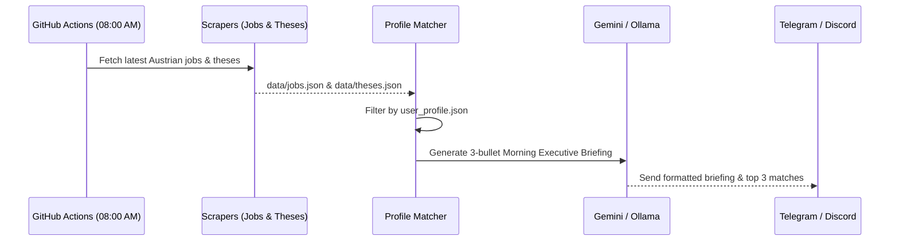

# 🚀 Architectural Plan: Personalized & Forkable Tech Career Hub

## 📌 Vision & Objective
Transform **Austria Tech Jobs & Thesis Hub** from a static aggregated dashboard into a **turnkey, personalized career engine**. Any user can fork the repository, run a 2-minute guided setup, and receive a customized dashboard, automated daily match scores, and personalized notifications (Telegram/Discord/Email) tailored to their unique tech stack, seniority, thesis interests, and salary goals.

---

## 🏛️ High-Level System Architecture



---

## 🗺️ Roadmap & Milestone Breakdown

### Milestone 1: Unified Profile Schema & Setup Wizard
**Goal:** Replace scattered environment variables with a single, clean user profile configuration.

- **1.1 Profile Schema (`config/profile.json`)**:
  ```json
  {
    "user": {
      "name": "Jane Doe",
      "target_roles": ["Full Stack Developer", "Backend Engineer"],
      "interests": ["Full-Time Jobs", "Master Theses"],
      "thesis_topics": ["AI & Data Science", "Cybersecurity & Networks"],
      "skills": {
        "core": ["Python", "Docker", "PostgreSQL", "FastAPI"],
        "familiar": ["React", "TypeScript", "AWS"],
        "learning": ["Rust", "PyTorch"]
      },
      "preferences": {
        "locations": ["Vienna", "Remote"],
        "min_salary": 55000,
        "include_no_salary": true,
        "seniority": ["Junior", "Mid-Level"],
        "visa_sponsorship_needed": false
      }
    },
    "notifications": {
      "channel": "telegram",
      "daily_digest": true,
      "min_match_score": 70
    }
  }
  ```
- **1.2 Interactive CLI Wizard (`scripts/configure.py`)**:
  - Prompts the user or auto-extracts skills from their master resume (`resume/resume.tex`).
  - Sets up `.env` and exports GitHub Secrets/Variables automatically if GitHub CLI (`gh`) is authenticated.
- **1.3 Git Safety**:
  - `config/profile.json` is gitignored by default; a template `config/profile.example.json` is committed to the repo.

---

### Milestone 2: Automated Match Scoring & "🎯 For You" Feed
**Goal:** Instantly surface jobs and thesis topics tailored to the user's specific skill set.

- **2.1 Fast Match Scorer (`scripts/match_scorer.py`)**:
  - Lightweight, deterministic rule engine (no LLM latency required for browsing).
  - Evaluates:
    - **Skill Overlap** (Core skills weighted 2x, familiar 1x, negative penalty for explicitly excluded keywords).
    - **Role & Seniority Fit** (Junior/Mid match vs Lead mismatch).
    - **Location & Salary Gate**.
  - Computes a `0–100% Match Score` and breakdown of matched skills vs gaps.
- **2.2 Web Dashboard Personalization (`app.js` & `theses.js`)**:
  - New **"🎯 For You"** view placed first in the filter bar.
  - Cards display a match pill: `🎯 92% Match (Matched: Python, Docker · Gap: Kubernetes)`.
  - In public GitHub Pages mode (without local profile), graceful fallback to the general aggregator.

---

### Milestone 3: AI Morning Digest & Multichannel Alerts
**Goal:** Deliver a concise daily briefing directly to the user's phone.



- **3.1 Executive Morning Digest**:
  - Instead of dumping raw links, an AI agent crafts a morning executive summary:
    > ☕ **Good morning, Jane!**
    > We found **2 new roles** and **1 Master Thesis** matching your Python & Cloud profile today:
    > 1. **Backend Engineer @ Bitpanda** (Vienna) — €62,000/yr (94% Match)
    > 2. **Cloud Software Engineer @ Dynatrace** (Vienna/Remote) — €58,000/yr (89% Match)
    > 3. **Master Thesis: LLMs in Cloud Observability @ Dynatrace Lab** (88% Match)
- **3.2 Discord Webhook Support (`scripts/send_discord.py`)**:
  - Zero-bot setup: Users only need to paste a Discord Webhook URL to get rich embedded cards in a private Discord channel.

---

### Milestone 4: Portable Application Tracker (Cross-Device Sync)
**Goal:** Ensure users can track applications from their phone on GitHub Pages without losing data on their desktop.

| Sync Strategy | Pros | Cons | Recommendation |
|:---|:---|:---|:---|
| **A. LocalStorage + JSON Export/Import** | 100% offline, zero setup, private | Manual transfer between devices | **Baseline (Immediate)** |
| **B. GitHub Private Gist Sync** | Free, permanent, uses existing GitHub auth | Requires a personal access token (PAT) | **Phase 4A (Seamless for devs)** |
| **C. Supabase / PocketBase Integration** | Real-time multi-device sync, passwordless login | Requires free Supabase account | **Phase 4B (Optional cloud)** |

---

### Milestone 5: "1-Click Fork" Template Experience
**Goal:** Anyone visiting the repository can start using it in under 3 minutes.

1. **GitHub Template Repository**: Enable *"Use this template"* button on the repo.
2. **Onboarding Action Workflow**: A first-run GitHub Action welcomes the user, validates their repository permissions, and creates an issue with their checklist.
3. **Region Flexibility**: Parameterize country presets (`AT` for Austria, `DE` for Germany, `CH` for Switzerland) in `config/profile.json` so the architecture can be adopted for other European hubs.
